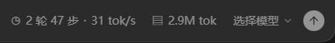
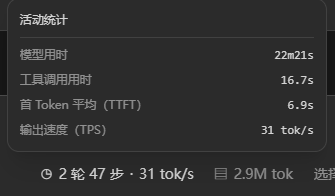
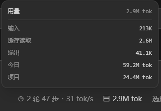

# ZCode Token 统计（Harness 双胶囊版）


> **非官方项目**：与 ZCode / DeepSeek 官方无关，不提供任何担保。安装会修改本地 ZCode 文件（`app.asar`、`zcode.cjs`），安装前自动备份，卸载可恢复原始文件。

在 ZCode 输入框工具栏显示两个与 DeepSeek Harness 同结构的统计胶囊：

- 活动：`1 轮 120 步 · 51 tok/s`，带仪表盘图标。
- 用量：`25.8M tok`，带数据库图标；缓存命中率使用 ZCode 原生的上下文面板，不重复显示。
- 点击任一胶囊，在其上方打开明细面板；点击外部或按 Esc 关闭。
- 活动面板：会话标题、轮/步数、模型耗时、工具耗时、速度；模型耗时缺失时回退真实生成耗时。
- 用量面板：精确总 Token，以及输入、缓存读取、缓存写入、输出。
- 子代理会话的用量会汇总进总 Token，并在面板中单独显示“子代理”一行。
- 无会话或无数据时不显示胶囊。

## 统计口径

- 速度：已完成模型请求的输出 Token 总量 ÷ 真实生成耗时总量，按请求加权。
- Token：ZCode 的 `inputTokens` 是包含缓存的总输入；补丁先拆成未缓存输入、缓存读取、缓存写入，再与输出相加，避免缓存重复计数。
- 请求按 `eventKey` 去重；切换工作区或会话时不会显示上一会话的数据。
- 数字格式与 Harness 对齐：速度小于 10 保留一位小数；Token 使用 `K` / `M`；缓存命中率不在本面板重复展示，交给 ZCode 原生上下文面板。

## 数据边界

- ZCode 当前 UI 提供 `generationDurationMs`，没有 Harness 所用的首 Token 时间，因此速度指标不保证逐值相同，也不使用字符估算或整轮耗时替代。
- 活动步数来自调试接口中可观察到的请求，轮数来自当前快照窗口；调试接口本身最多保留最近 200 条，补丁持续打开会话时合并去重历史，最多 2,000 条。首次打开的旧会话可能看不到更早的速度/步数记录。
- 用量使用完整会话累计快照，不受调试窗口限制。
- 子代理通过 `listSessionSubagents` 找到，运行中的子会话每 5 秒刷新，已结束的只读一次。子会话优先使用完整任务用量接口 `getTaskTokenUsage`；只有该接口不可用时才回退到调试记录，超过 200 条会标记为部分统计。
- Workflow 子会话通过快照 `workflowRuns[].actors[].sessionId` 发现，并使用同一完整用量接口汇总；没有 actor 会话 ID 的工作流无法拆分 Token 明细。

## 自动适配

补丁不再写死 Vite 的 `styles-<hash>.js` 文件名，也不依赖 `X0t`、`Q`、`$`、`fp`、`du` 这些压缩名。安装时会：

- 按内容特征在渲染资源中查找唯一 bundle。
- 用 AST 通过 `data-usage-used` 定位工具栏组件和插入位置。
- 自动发现 React、JSX runtime、Portal 和 `zcodeAgentService` 的当前别名。
- 自动查找组件包装别名及调用方，把会话快照桥接进来。
- 重新解析生成结果；若结构不唯一、接口被重构或无法找到快照来源，则拒绝安装并恢复原包。

因此 ZCode 小版本更新导致的重新压缩、函数/变量改名、文件名变化，通常只需重新运行一次 `apply`，不用改补丁源码。

不能保证的部分：ZCode 重构输入框组件结构、删除 `data-usage-used`/`snapshot` 接口，或改掉调试用量接口。此时脚本会安全失败，而不会生成可能白屏的包。

## 快速安装

1. 从 [Releases 最新版](https://github.com/Freegg-top/zcode-token-stats/releases/latest) 下载 `ZCode-Token-Stats-*-win-x64.zip`，并核对 sha256。
2. 解压到可写目录（不要在压缩包内直接运行）。
3. 双击 `安装.cmd`，按菜单选择操作；安装完成后手动打开 ZCode。

详细步骤与常见问题见 [安装说明.md](安装说明.md)。

## 使用

完全退出 ZCode（包括托盘）后：

```powershell
node patch.js check
node patch.js apply
# 重新打开 ZCode

# 仅卸载 Token 统计补丁
node patch.js remove
```

补丁目标按以下顺序自动定位：命令行传入的路径 → 环境变量 `ZCODE_ASAR` → `%LOCALAPPDATA%\Programs\ZCode`；自定义安装位置可设置 `ZCODE_HOME`（安装器）或在命令末尾显式传入 app.asar 路径。安装器（`安装.cmd`）另支持运行中 ZCode 进程、Program Files 与注册表卸载项定位。安装前自动备份，打包后校验 JavaScript 语法、补丁标记、原生 unpacked 文件哈希；失败会恢复。重复 `apply` 会只替换本补丁，保留其他本地渲染改动。

## 从插件市场安装（可选）

本仓库同时是 ZCode 插件市场，提供 `/install-overlay`（安装/升级）、`/uninstall-overlay`（卸载）命令：

1. 打开 **插件市场（Plugin Marketplace）→ 添加 → 添加插件市场**，粘贴仓库地址 `https://github.com/Freegg-top/zcode-token-stats`。
2. 在市场列表中安装 **ZCode Token 统计**（zcode-token-stats）。
3. 安装插件后**无需手动操作**：每次会话启动时自动检测注入状态；若缺失（首次安装或 ZCode 升级覆盖），在你完全退出 ZCode 时自动完成注入、校验并重启 ZCode，日志见 `%LOCALAPPDATA%\ZCodeTokenStats\auto-apply.log`。不希望自动重启时，给 hooks.json 里该 hook 加 `-NoRelaunch` 参数即可（注入仍会完成，下次手动打开生效）。
4. 也可在新会话手动运行 `/install-overlay` 安装或升级；若 GitHub 源无法添加，先 `git clone` 本仓库，再以仓库根目录（`marketplace.json` 所在目录）作为市场根添加。

## 界面预览



活动面板：模型用时、工具调用用时、TTFT、输出速度（TPS）。



用量面板：输入、缓存读取、输出、今日与项目累计。



## 文件

- `stats-core.js`：可测试的统计、格式化、去重和轮/步聚合。
- `renderer-component.txt`：两个胶囊、点击展开面板和轮询组件。
- `patch-lib.js`：自动匹配成功后的文本构建与卸载。
- `auto-patch.cjs`：基于 acorn 的组件、调用点和运行时别名定位。
- `patch.js`：动态 bundle 查找、检查、安装、卸载与恢复。
- `test-dsh.cjs`：整包语法、组件点击渲染、统计口径、模拟新版重命名和精确还原测试。

```powershell
node --experimental-vm-modules test-dsh.cjs
```

参考：[Harness StatsPills](https://github.com/deepseek-ai/deepseek-harness/blob/master/packages/client/ui-chat/src/client/chat/StatsPills.tsx)、[stat dialog CSS](https://github.com/deepseek-ai/deepseek-harness/blob/master/packages/client/ui-chat/src/client/chat/stat-dialog.module.css)、[session-stats](https://github.com/deepseek-ai/deepseek-harness/blob/master/packages/session/session-stats/src/projection.ts)。

只修改本地渲染层，不修改模型请求、计费或上下文用量。

## 手动更新模式

本工具不包含自动维护任务、常驻脚本或登录启动项。ZCode 更新后重新运行 `install.cmd` 选择 `[1] 安装 / 更新` 即可；卸载会恢复备份。

## 备份与恢复

- direct 模式不修改 `zcode.cjs`，也不生成完整 `app.asar` 备份。
- 安装只向主入口追加一行 loader 引用；卸载只删除该行，主入口自动恢复原状。
- 运行时位于 `%LOCALAPPDATA%\ZCodeTokenStats\direct`，卸载时一并删除。
- 旧版（1.x）的 `app.asar.zts-original`、`zcode.cjs` 备份和 `%LOCALAPPDATA%\ZCodeTokenStats\backup` 会在新安装器运行时自动清理。

## 发布包

GitHub Release 提供 `ZCode-Token-Stats-1.0.0-direct-win-x64.zip`。解压后根目录只保留 `安装.cmd`、`检查.cmd`、`卸载.cmd` 和说明文档，补丁与依赖位于 `_internal`。当前暂不提供无签名 exe。
